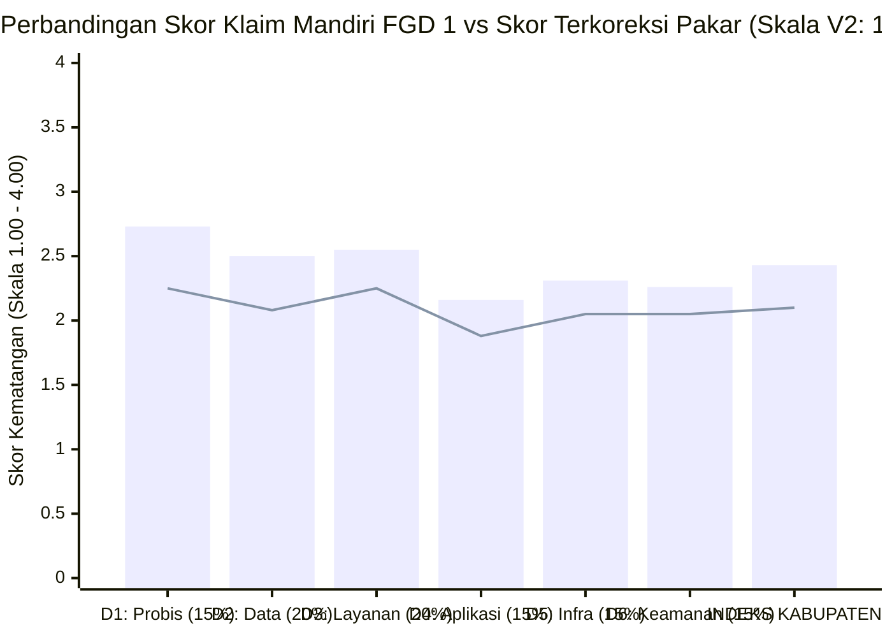

# LAPORAN ANALISIS AWAL FGD PERTAMA & EVALUASI PAKAR (*DESK EVALUATION*) KEMATANGAN PEMERINTAHAN DIGITAL KABUPATEN LANDAK TAHUN 2026

**Disusun oleh:** Tenaga Ahli / Pakar Arsitektur Pemerintahan Digital (PEMDI / SPBE) Kabupaten Landak  
**Basis Data:** Hasil Kuesioner FGD Pertama (32 Entri $\rightarrow$ 31 Unit Kerja Unik), Panduan Teknis Evaluasi Kuesioner Versi 2 (Bobot Tertimbang Level 1–4), Laporan Hasil Asistensi SPBE Diskominfo 2026, dan Laporan Asesmen Kesiapan Digital KOMDIGI 2026.

---

## 1. Pengantar Pakar & Kurasi Daftar 31 Responden FGD Pertama

Pada pelaksanaan *Focus Group Discussion* (FGD) Pertama pemetaan Pemerintahan Digital (PEMDI/SPBE) Kabupaten Landak, telah terkumpul **32 baris isian kuesioner mandiri (*self-assessment*)** dari perangkat daerah. Sebagai langkah pertama analisis pakar, dilakukan **kurasi dan pembersihan entri responden (*data cleansing*)** sesuai struktur organisasi dan kualitas keterwakilan data sebagai berikut:

> [!IMPORTANT]
> **Keputusan Kurasi 31 Unit Kerja Definitif pada FGD Pertama:**
> 1. **Pemisahan Entitas Dinas Kesehatan & Puskesmas:**
>    * **Dinas Kesehatan, PPKB Kabupaten Landak** (Responden: *Marlinda, S.M* – Penata Layanan Operasional, Skor Mandiri: **2,57**) ditetapkan mewakili Dinas Kesehatan Induk.
>    * **Dinas Kesehatan / Puskesmas Ngabang** (Responden: *Eliskawati* – Perawat Penyelia / Kasubag TU, Skor Mandiri: **2,85**) ditetapkan sebagai entitas layanan fasilitas kesehatan tersendiri (UPTD Puskesmas Ngabang).
> 2. **Pengambilan Data Terbaik untuk Sekretariat Daerah:**
>    * Terdapat 2 entri dari Sekretariat Daerah, yaitu **Sekretariat Daerah Kabupaten Landak** (*Devi Kartika Sari* – Skor Mandiri: **2,83**) dan **Sekretariat Daerah Bagian PBJ** (*Kurnia Witri Siregar* – Skor Mandiri: **1,90**). Sesuai kaidah keterwakilan instansi induk, diambil data terbaik (**Skor 2,83**) untuk mewakili **Sekretariat Daerah Kabupaten Landak**.
> 3. **Penambahan Responden Baru (Unit Kerja ke-31):**
>    * **Rumah Sakit Pratama** (Responden: *Riovanus Astianto Gae, S.Kom.* – Pranata Komputer, pengisian `2026-11-03`, Skor Mandiri: **2,44**) resmi dimasukkan sebagai responden ke-31.

Dengan demikian, jumlah unit analisis hasil FGD Pertama secara definitif adalah **31 Perangkat Daerah / Unit Kerja**.

---

## 2. Metodologi Kalibrasi Pakar: Mengapa Skor FGD Pertama Harus Dikoreksi?

Berdasarkan pemeriksaan terhadap matriks jawaban FGD Pertama dan penyandingan dengan **Panduan Teknis Evaluasi & Penilaian Kuesioner SPBE/PEMDI Versi 2**, ditemukan dua kondisi mendasar yang mengharuskan Tenaga Ahli melakukan **Koreksi Skor Evaluator (*Desk Evaluation*)**:

### A. Konversi ke Skala Level 1–4 dan Rumus Bobot Tertimbang (Panduan Teknis V2)
Instrumen yang diisi pada FGD Pertama masih menggunakan opsi `a` s.d. `e` (Skala 1–5 tanpa bobot domain), sedangkan **Panduan Teknis Evaluasi Versi 2** menetapkan standar baku pengukuran tingkat kabupaten menggunakan **Skala Berjenjang Level 1 s.d. Level 4** dengan **Bobot Domain Tertimbang**:
* **Domain 1: Proses Bisnis ($R_{\text{PB}}$)** = Bobot **15%**
* **Domain 2: Data dan Informasi ($R_{\text{DI}}$)** = Bobot **20%**
* **Domain 3: Layanan ($R_{\text{LY}}$)** = Bobot **20%**
* **Domain 4: Aplikasi ($R_{\text{AP}}$)** = Bobot **15%**
* **Domain 5: Infrastruktur ($R_{\text{IF}}$)** = Bobot **15%**
* **Domain 6: Keamanan Informasi ($R_{\text{KM}}$)** = Bobot **15%**

$$\text{Indeks SPBE OPD} = (R_{\text{PB}} \times 15\%) + (R_{\text{DI}} \times 20\%) + (R_{\text{LY}} \times 20\%) + (R_{\text{AP}} \times 15\%) + (R_{\text{IF}} \times 15\%) + (R_{\text{KM}} \times 15\%)$$

### B. Penerapan Aturan Verifikasi Bukti Dukung (*Evidence Check Rules* – Bab 6 Panduan Teknis V2)
Pada data Excel FGD Pertama, kolom **`Upload Bukti Dukung (Evidence)` masih kosong pada seluruh 31 responden (0% terunggah)**. Sesuai **Bab 6 Panduan Teknis Evaluasi Versi 2**, klaim mandiri (*self-assessment*) Level 3 atau Level 4 yang tidak disertai bukti dukung sah atau bertentangan dengan fakta lapangan pada *Laporan Asistensi Diskominfo 2026* & *Asesmen KOMDIGI 2026* **wajib dikoreksi maksimal ke Level 2,00**:

| Domain SPBE | Aturan Koreksi Skor Evaluator (Bab 6 Panduan Teknis V2) | Fakta Silang Asistensi Diskominfo & Asesmen KOMDIGI 2026 |
| :--- | :--- | :--- |
| **1. Proses Bisnis** | Jika belum melampirkan Dokumen Peta Proses Bisnis (BPMN/SIPOC) & SK Kepala OPD, skor dikoreksi **maksimal ke Level 2,00**. | Skor Probis Lintas-OPD KOMDIGI = **0,00**. Namun penggunaan *SRIKANDI*, *e-Kinerja*, & *SIM-TPP* terbukti aktif di lapangan (diakui s.d. Level 3,00). |
| **2. Data & Informasi** | Jika data tidak aktif terhubung ke Portal Satu Data Landak / SITUASI beserta kamus data/metadata, skor **maksimal Level 2,00**. | Perbup Satu Data No. 54/2020 & portal *SITUASI* sudah berjalan (**Skor KOMDIGI 1,50**), namun SK Produsen Data & Katalog Data di internal OPD sebagian besar belum disahkan. |
| **3. Layanan** | Jika layanan belum *end-to-end* online dan belum punya SK SLA resmi, skor **maksimal Level 2,00** (kecuali OPD yang terbukti memiliki layanan online di Laporan Asistensi). | Dari 196 layanan, **155 layanan (79,1%) masih offline**. Hanya 17 OPD yang terbukti memiliki aplikasi layanan online aktif. |
| **4. Aplikasi** | Jika tidak ada Surat Rekomendasi (*Clearance*) Diskominfo, BAST *Source Code*, & Repositori, skor aplikasi khusus **maksimal Level 2,00**. | Siklus hidup aplikasi & API Gateway pada Asesmen KOMDIGI = **0,00**. Sebanyak 73,3% OPD mengakui tidak punya API & tidak punya SSO. |
| **5. Infrastruktur** | Jika server masih fisik mandiri/vendor luar tanpa izin atau belum terhubung JIP, skor **maksimal Level 2,00**. | Asesmen KOMDIGI mencatat **JIP baru terhubung di 2 titik (Diskominfo & DPMPTSP)**, **0 sistem berada di PDN**, dan baru **6 OPD yang memakai Router Mikrotik**. |
| **6. Keamanan Informasi** | Jika tidak ada laporan *PenTest/VA*, SOP Keamanan resmi, atau DRP tertulis, skor **maksimal Level 2,00**. | Asesmen KOMDIGI mencatat Keamanan Teknologi, Data, Aplikasi, & DRP = **0,00**, sedangkan Tim Tanggap Insiden (*LandakKab-CSIRT*) & TTE BSrE sudah berjalan baik. |

---

## 3. Temuan Anomali & *Overclaim* pada Data FGD Pertama

Sebelum dilakukan koreksi pakar, ditemukan **83 titik anomali klaim (*overclaim*)** di mana responden memilih opsi **Level 4 (`d`) atau Level 5 (`e`)** yang bertentangan langsung dengan fakta *Laporan Asistensi 2026*. Berikut adalah **6 temuan anomali utama** yang harus diklarifikasi pada FGD Kedua:

1. **Anomali Klaim Penempatan Server di Pusat Data Nasional (PDN):**
   * **Temuan FGD 1:** **Dinas PUPRPERA** dan **Dinas Sosial P3A** menjawab **Opsi d (Level 4): *"Ditempatkan di Pusat Data Nasional (PDN) / Cloud Resmi Pemerintah"***.
   * **Fakta Lapangan 2026:** Berdasarkan *Laporan Hasil Asistensi 2026 (Halaman 45)*, dari 50 Sistem Elektronik yang terdata di Kabupaten Landak, **jumlah sistem pada Server PDN adalah 0 sistem** (25 di Server Diskominfo, 23 di Pihak Ketiga, 2 di Lokal OPD).
2. **Anomali Klaim Penerapan *Secure by Design*, Audit BSSN, & *Penetration Testing*:**
   * **Temuan FGD 1:** **Dinas Perkebunan & Peternakan** menjawab **Opsi e (Level 5): *"Menerapkan standar Secure by Design hingga audit keamanan berkala oleh BSSN"***; **Dinas Kesehatan / Puskesmas Ngabang** menjawab **Opsi d (Level 4): *"Menjalani Penetration Testing resmi dan memiliki Surat Kelayakan Keamanan"***; dan **Sekretariat Daerah** menjawab **Opsi d (Level 4)** pada uji *Penetration Testing* berkala.
   * **Fakta Lapangan 2026:** Asesmen KOMDIGI 2026 (Tabel 13) mencatat skor **Audit Keamanan Aplikasi = 0 (Belum Siap)** karena pengujian keamanan aplikasi belum pernah dilaksanakan secara operasional, dan website Setda (`setda.landakkab.go.id`) justru berstatus *Suspend*.
3. **Anomali Klaim Kontradiktif pada Pencadangan Data (*Backup*) & Keberadaan Aplikasi:**
   * **Temuan FGD 1:** **Satuan Polisi Pamong Praja** menjawab **Opsi e (Level 5): *"Pencadangan berjalan otomatis real-time, terenkripsi, dan diuji pemulihannya secara berkala"*** pada Pertanyaan D6.3, tetapi pada Pertanyaan D6.4 langsung di bawahnya menjawab **Opsi a (Level 1): *"Data cadangan disimpan di komputer/harddisk kerja yang sama"***. Selain itu, Satpol PP mengklaim **Level 4 (Layanan digital 24/7)** dan **Level 5 (*Once-Only* penuh)** padahal pada Domain Aplikasi menjawab **Opsi a: *"Belum memiliki aplikasi khusus"*** dan belum memiliki website profil.
4. **Anomali Klaim Keterhubungan Otomatis via SPLP & API Aktif:**
   * **Temuan FGD 1:** **Kecamatan Ngabang, Bappeda, Disdukcapil, Dinkes/Puskesmas Ngabang, Diskumindag,** dan **Rumah Sakit Pratama** mengklaim **Opsi d (Level 4): *"Terhubung otomatis antar-aplikasi melalui Sistem Penghubung Layanan Pemerintah (SPLP)"***.
   * **Fakta Lapangan 2026:** Asesmen KOMDIGI 2026 (Tabel 17) menegaskan bahwa desain dan arsitektur pertukaran data melalui API Gateway/SPLP Daerah **belum tersedia (Skor 0,00)**.
5. **Anomali Klaim Keterhubungan Jaringan Intra Pemerintah (JIP):**
   * **Temuan FGD 1:** **BPRD** mengklaim terhubung JIP di beberapa bidang (**Level 3**), padahal Laporan Asesmen KOMDIGI 2026 (Halaman 69) mencatat bahwa konektivitas Jaringan Intra Pemerintah saat ini **baru tersedia pada dua titik utama, yaitu Diskominfo dan DPMPTSP**.
6. **Anomali Klaim *Once-Only Principle* & *Zero Document*:**
   * **Temuan FGD 1:** **BKAD, Dinas Kearsipan & Perpustakaan, Satpol PP, Setda,** dan **Disperinnaker** mengklaim **Opsi e (Level 5): *"Pemohon tidak perlu mengisi atau mengunggah dokumen dasar apa pun karena sistem saling terhubung penuh"***, serta **Dinas Pendidikan** mengklaim penarikan data KTP/NIK otomatis dari database Dukcapil (**Level 4**), padahal web service Dukcapil ke OPD tersebut belum terhubung secara *host-to-host*.

---

## 4. Ringkasan Eksekutif Skor Kematangan Kabupaten Landak (Mandiri vs Terkoreksi Pakar)

Setelah dilakukan penghitungan terhadap **31 Perangkat Daerah / Unit Kerja** menggunakan rumus bobot tertimbang **Panduan Teknis Evaluasi Versi 2 (Skala 1,00 – 4,00)**, diperoleh perbandingan capaian tingkat kabupaten sebagai berikut:

| No | Domain SPBE / PEMDI | Bobot Domain (V2) | Rata-Rata Klaim Mandiri FGD 1 (Skala 1–5) | Rata-Rata Klaim Mandiri Konversi V2 (Skala 1–4) | **Rata-Rata Terkoreksi Pakar V2 (Skala 1–4)** | Selisih Koreksi ($\Delta$) | Status Kesiapan Riil Daerah (*Verified Baseline*) |
| :-: | :--- | :---: | :---: | :---: | :---: | :---: | :--- |
| 1 | **Domain 1: Proses Bisnis** | **15%** | 2,77 | 2,73 | **2,25** | $-0,48$ | **Kurang (Awal / Rintisan)** – Minim SK Probis & SOP |
| 2 | **Domain 2: Data & Informasi** | **20%** | 2,52 | 2,50 | **2,08** | $-0,42$ | **Kurang (Awal / Rintisan)** – Katalog OPD & UU PDP lemah |
| 3 | **Domain 3: Layanan** | **20%** | 2,57 | 2,55 | **2,25** | $-0,30$ | **Kurang (Awal / Rintisan)** – 79,1% layanan masih offline |
| 4 | **Domain 4: Aplikasi** | **15%** | 2,19 | 2,16 | **1,88** | $-0,29$ | **Kurang (Terendah)** – Tanpa API, tanpa SSO, tanpa Clearance |
| 5 | **Domain 5: Infrastruktur** | **15%** | 2,32 | 2,31 | **2,05** | $-0,26$ | **Kurang (Awal / Rintisan)** – JIP baru 2 titik, 0 di PDN |
| 6 | **Domain 6: Keamanan Informasi** | **15%** | 2,27 | 2,26 | **2,05** | $-0,21$ | **Kurang (Awal / Rintisan)** – 0% DRP, backup di flashdisk |
| **TOTAL** | **INDEKS KEMATANGAN KABUPATEN (31 UNIT)** | **100%** | **2,44 / 5,00** | **2,43 / 4,00** | **2,10 / 4,00** | **$-0,33$** | **Predikat: KURANG (Tingkat Kesiapan: Awal / Rintisan)** |

> [!TIP]
> **Kesimpulan Diagnostik Pakar:**
> Secara klaim mandiri (*unverified*), terdapat **11 OPD** yang mengklaim sudah berada pada predikat **Cukup / Baik ($\ge 2,51$)**. Namun, setelah diterapkan **Aturan Verifikasi Bukti Dukung (Bab 6 Panduan Teknis V2)**, hanya **1 OPD yaitu Dinas Komunikasi dan Informatika (Skor Terkoreksi: 2,55)** yang bertahan pada predikat **Cukup (Berkembang)** berkat bukti faktual pengelolaan pusat data, JIP, portal Satu Data/SITUASI, dan LandakKab-CSIRT, diikuti oleh **Dinas Pendidikan (2,51)**. Sementara **26 OPD berada pada predikat Kurang (Awal/Rintisan: $1,76 - 2,50$)** dan **3 OPD berada pada predikat Sangat Kurang (Belum Siap: $< 1,76$)**.

---

## 5. Tabel Rekapitulasi Evaluasi 31 OPD: Skor Klaim Mandiri FGD 1 vs Skor Terkoreksi Pakar (Formula V2)

*(File tabel lengkap ini juga telah diekspor ke dalam format CSV/Excel pada [rekapitulasi_evaluasi_fgd1_31_opd_terkoreksi.csv](file:///Users/untan/.gemini/antigravity/brain/e1949b1d-9f76-4120-b95a-ea31cf636a58/rekapitulasi_evaluasi_fgd1_31_opd_terkoreksi.csv))*

| Rank | Nama Perangkat Daerah / Unit Kerja (31 Unit) | Nama Responden | Skor Mandiri (1–5) | Indeks Mandiri V2 (1–4) | $R_{\text{PB}}$ (15%) | $R_{\text{DI}}$ (20%) | $R_{\text{LY}}$ (20%) | $R_{\text{AP}}$ (15%) | $R_{\text{IF}}$ (15%) | $R_{\text{KM}}$ (15%) | **Indeks Terkoreksi Pakar V2** | Koreksi ($\Delta$) | Predikat Terkoreksi (Standar V2) | Jml Anomali |
| :-: | :--- | :--- | :-: | :-: | :-: | :-: | :-: | :-: | :-: | :-: | :-: | :-: | :--- | :-: |
| **1** | **Dinas Komunikasi dan Informatika** | Irna Rafidah | 2,93 | 2,90 | 2,50 | 2,60 | 2,70 | 1,80 | 2,95 | 2,70 | **2,55** | $-0,34$ | **Cukup (Berkembang)** | 1 |
| **2** | **Dinas Pendidikan** | Thedriana Riri | 3,27 | 3,26 | 2,60 | 2,40 | 2,80 | 2,35 | 2,44 | 2,40 | **2,51** | $-0,75$ | **Cukup (Berkembang)** | 7 |
| **3** | **Dinas Penanaman Modal dan PTSP** | Govetro Eko Cahyono | 2,80 | 2,81 | 2,40 | 2,20 | 2,75 | 2,10 | 2,75 | 2,30 | **2,42** | $-0,39$ | Kurang (Awal / Rintisan) | 3 |
| **4** | **Badan Pajak dan Retribusi Daerah** | Martinus Alfred | 2,92 | 2,92 | 2,50 | 2,40 | 2,65 | 2,30 | 2,33 | 2,20 | **2,41** | $-0,51$ | Kurang (Awal / Rintisan) | 7 |
| **5** | **Inspektorat** | Zaki Sarjudin | 2,68 | 2,68 | 2,25 | 2,30 | 2,90 | 2,15 | 2,11 | 2,40 | **2,38** | $-0,31$ | Kurang (Awal / Rintisan) | 1 |
| **6** | **Dinas Kesehatan / Puskesmas Ngabang** | Eliskawati | 2,85 | 2,84 | 2,35 | 2,30 | 2,60 | 2,10 | 2,10 | 2,35 | **2,31** | $-0,52$ | Kurang (Awal / Rintisan) | 4 |
| **7** | **Dinas PUPR dan Perumahan Rakyat** | Yoelretno Putra K. | 2,78 | 2,78 | 2,35 | 2,20 | 2,60 | 2,25 | 2,10 | 2,20 | **2,29** | $-0,49$ | Kurang (Awal / Rintisan) | 5 |
| **8** | **Sekretariat Daerah Kabupaten Landak** | Devi Kartika Sari | 2,83 | 2,79 | 2,55 | 2,00 | 2,60 | 2,15 | 2,10 | 2,25 | **2,28** | $-0,51$ | Kurang (Awal / Rintisan) | 5 |
| **9** | **Badan Keuangan dan Aset Daerah** | Christina Hutahaean | 2,73 | 2,68 | 2,55 | 2,30 | 2,70 | 1,55 | 2,00 | 2,00 | **2,21** | $-0,46$ | Kurang (Awal / Rintisan) | 5 |
| **10** | **RSUD Landak** | Supriyatno, S.Kom. | 2,44 | 2,45 | 2,05 | 2,10 | 2,50 | 2,20 | 2,11 | 2,20 | **2,20** | $-0,25$ | Kurang (Awal / Rintisan) | 3 |
| **11** | **BKPSDM** | Agnes Ega Mariska | 2,44 | 2,43 | 2,55 | 1,80 | 2,70 | 1,90 | 2,33 | 1,90 | **2,20** | $-0,22$ | Kurang (Awal / Rintisan) | 1 |
| **12** | **Dinas Kesehatan, PPKB Kabupaten Landak** | Marlinda, S.M | 2,57 | 2,60 | 2,45 | 2,20 | 2,70 | 1,45 | 2,00 | 2,20 | **2,20** | $-0,40$ | Kurang (Awal / Rintisan) | 3 |
| **13** | **Badan Kesatuan Bangsa dan Politik** | Cavlin Ivan W. | 2,38 | 2,38 | 2,10 | 1,70 | 2,60 | 2,15 | 2,20 | 2,20 | **2,16** | $-0,22$ | Kurang (Awal / Rintisan) | 0 |
| **14** | **Bappeda** | Yohanes Rahmad | 2,63 | 2,67 | 2,25 | 2,20 | 2,30 | 2,15 | 2,00 | 1,95 | **2,15** | $-0,52$ | Kurang (Awal / Rintisan) | 7 |
| **15** | **Dinas Kependudukan dan Pencatatan Sipil** | Laudy Van Cliff M. | 2,66 | 2,68 | 2,40 | 2,20 | 2,50 | 1,60 | 2,22 | 1,80 | **2,14** | $-0,53$ | Kurang (Awal / Rintisan) | 7 |
| **16** | **Rumah Sakit Pratama** *(Responden Baru)* | Riovanus Astianto G. | 2,44 | 2,43 | 2,35 | 1,80 | 2,60 | 1,65 | 2,00 | 2,20 | **2,11** | $-0,32$ | Kurang (Awal / Rintisan) | 2 |
| **17** | **Dinas Lingkungan Hidup** | Nella Yuliarni, S.Kom | 2,27 | 2,23 | 2,15 | 2,10 | 1,80 | 1,95 | 2,22 | 2,30 | **2,07** | $-0,16$ | Kurang (Awal / Rintisan) | 1 |
| **18** | **Badan Penanggulangan Bencana Daerah** | Arie Pratama, S.Kom | 2,32 | 2,32 | 1,95 | 2,30 | 1,90 | 2,15 | 2,00 | 2,00 | **2,05** | $-0,27$ | Kurang (Awal / Rintisan) | 4 |
| **19** | **Dinas Perkebunan dan Peternakan** | Selpanus Roni, S.Kom | 2,31 | 2,26 | 2,10 | 2,30 | 1,90 | 1,90 | 1,78 | 2,25 | **2,04** | $-0,22$ | Kurang (Awal / Rintisan) | 4 |
| **20** | **Dinas Pemberdayaan Masyarakat dan Desa** | Adrian Mulyawan | 2,23 | 2,21 | 2,25 | 2,00 | 1,90 | 2,15 | 1,90 | 2,00 | **2,02** | $-0,18$ | Kurang (Awal / Rintisan) | 1 |
| **21** | **Dinas Perhubungan** | Pricillia K. A. R. | 2,10 | 2,10 | 2,25 | 2,30 | 2,00 | 1,70 | 1,70 | 2,05 | **2,01** | $-0,09$ | Kurang (Awal / Rintisan) | 0 |
| **22** | **Dinas Kearsipan dan Perpustakaan** | Dedyk Apriana | 2,37 | 2,39 | 2,25 | 2,20 | 2,00 | 1,75 | 2,00 | 1,70 | **2,00** | $-0,40$ | Kurang (Awal / Rintisan) | 4 |
| **23** | **Dinas Sosial, P3A** | Rara Kinasih | 2,30 | 2,29 | 2,15 | 2,00 | 2,20 | 1,60 | 1,90 | 1,70 | **1,94** | $-0,35$ | Kurang (Awal / Rintisan) | 5 |
| **24** | **Dinas Ketahanan Pangan dan Pertanian** | Ya' Alfiansyah | 2,15 | 2,12 | 2,15 | 1,90 | 1,90 | 1,70 | 1,70 | 2,20 | **1,92** | $-0,20$ | Kurang (Awal / Rintisan) | 0 |
| **25** | **Dinas Perindustrian dan Tenaga Kerja** | Yudi Suhendra | 2,29 | 2,25 | 2,20 | 1,70 | 2,20 | 1,70 | 2,11 | 1,60 | **1,92** | $-0,33$ | Kurang (Awal / Rintisan) | 2 |
| **26** | **Kantor Kecamatan Ngabang** | Fransiska Evilia S. | 2,10 | 2,07 | 2,25 | 1,90 | 1,80 | 1.60 | 2,00 | 1,90 | **1,90** | $-0,17$ | Kurang (Awal / Rintisan) | 0 |
| **27** | **Sekretariat DPRD** | Joshua Edward | 1,95 | 1,91 | 2,10 | 1,50 | 1,70 | 1,50 | 2,33 | 2,00 | **1,83** | $-0,07$ | Kurang (Awal / Rintisan) | 1 |
| **28** | **Satuan Polisi Pamong Praja** | Yulita Yuniati D. | 2,31 | 2,23 | 2,25 | 2,00 | 1,50 | 1,45 | 1,78 | 1,60 | **1,76** | $-0,47$ | Kurang (Awal / Rintisan) | 7 |
| **29** | **Badan Riset dan Inovasi Daerah (BRIDA)** | Kristi Andriana | 1,93 | 1,92 | 1,65 | 1,80 | 1,70 | 1,85 | 1,89 | 1,65 | **1,76** | $-0,16$ | Kurang (Awal / Rintisan) | 0 |
| **30** | **Dinas Kebudayaan, Pemuda Olahraga & Pariwisata** | Ariani Wulandari | 1,86 | 1,86 | 1,85 | 1,90 | 1,70 | 1,55 | 1,22 | 1,90 | **1,70** | $-0,17$ | **Sangat Kurang (Belum Siap)** | 1 |
| **31** | **Dinas Koperasi, UKM dan Perdagangan** | Viktorianus Dely | 1,83 | 1,80 | 1,85 | 1,90 | 1,30 | 1,75 | 1,40 | 1,50 | **1,61** | $-0,19$ | **Sangat Kurang (Belum Siap)** | 0 |

---

## 6. Rekomendasi Tindak Lanjut Pakar Menuju FGD Kedua (Verifikasi & Pengumpulan Bukti Dukung)

Berdasarkan **Tahapan Operasional Evaluasi (Bab 7 Panduan Teknis V2)** dan strategi **Pra-Pengisian (*Pre-Populated Form*)** dari dokumen Gap Analysis 2026, berikut adalah langkah eksekusi yang harus dilakukan Tim Evaluator Diskominfo bersama Pakar sebelum menetapkan skor final LHE SPBE/PEMDI Daerah:

### 1. Menerbitkan Lembar Konfirmasi & Tagihan Bukti Dukung (*Pre-Populated Evidence Sheet*) ke 31 Unit Kerja
Kita **tidak perlu lagi menyuruh OPD mengetik ulang** daftar aplikasi umum, jumlah titik internet, atau alamat website profil mereka karena data tersebut sudah lengkap di *Laporan Asistensi 2026*. Sebaliknya, untuk memulihkan skor mereka yang terkoreksi ke Level 2,00, setiap OPD diberi waktu pada FGD Kedua untuk menyerahkan **4 Dokumen Bukti Dukung Wajib**:
1. **Bukti Domain 1 (Proses Bisnis):** Salinan PDF **SK Kepala OPD tentang Penetapan SOP / Peta Proses Bisnis** beserta nomor dokumennya (khusus bagi 26 OPD yang mengklaim sudah punya SOP/Probis).
2. **Bukti Domain 2 (Data & Informasi):** Salinan **SK Tim Pengelola Data / Produsen Data OPD** dan daftar *Dataset Sektoral* yang telah diunggah ke portal **SITUASI (`situasi.landakkab.go.id`)**.
3. **Bukti Domain 3 & 4 (Layanan & Aplikasi):** Daftar volume pemohon/transaksi riil per tahun pada layanan utama, serta **Dokumentasi Teknis Aplikasi Khusus** (Bahasa Pemrograman, Database, lokasi server riil, dan status ketersediaan API) terutama bagi 11 OPD pengelola 41 aplikasi khusus daerah (termasuk *RS Pratama* yang baru mengklaim sudah punya API ke SPLP).
4. **Bukti Domain 5 & 6 (Infrastruktur & Keamanan):** Salinan **SK Penunjukan Admin Website/Pengelola TIK** (untuk mengatasi 45,9% kekosongan admin), daftar pejabat pemegang **Sertifikat TTE BSrE aktif**, serta bukti prosedur *backup* database.

### 2. Fokus Khusus pada Responden Baru: Rumah Sakit Pratama
* **Profil FGD 1 Rumah Sakit Pratama:** Merupakan unit kerja baru (responden ke-31) yang sudah memiliki 1 Pranata Komputer (*Riovanus Astianto Gae, S.Kom.*) dengan skor mandiri **2,43** dan skor terkoreksi **2,11 (Predikat: Kurang / Awal Rintisan)**.
* **Temuan Penting pada RS Pratama:**
  * Belum memiliki petugas/SK pengelola data resmi (**Level 1**) dan belum memiliki kanal layanan digital/website khusus (**Level 1**), serta koneksi internet masih menggunakan langganan *broadband* rumahan yang sering terputus (**Level 2**).
  * Namun, RS Pratama mengklaim aplikasi khususnya telah memiliki **API yang terdaftar dan terhubung aktif dengan SPLP (Level 4)**—hal ini kemungkinan besar merujuk pada integrasi *SIMRS / e-klaim BPJS / SATUSEHAT Kemenkes*, sehingga perlu diverifikasi saat *Desk Evaluation* apakah sistem tersebut dikelola mandiri atau aplikasi umum Kementerian Kesehatan.
* **Rekomendasi Arsitektur untuk RS Pratama:** Memasukkan **Rumah Sakit Pratama** ke dalam target perluasan **Jaringan Intra Pemerintah (JIP)** dan program **PASTI BAKTI**, membuatkan subdomain resmi `rspratama.landakkab.go.id` di Server Diskominfo, serta menyelaraskan arsitektur *SIMRS* dan rujukan berjenjangnya (*SISRUTE*) dengan Puskesmas dan RSUD Landak.
